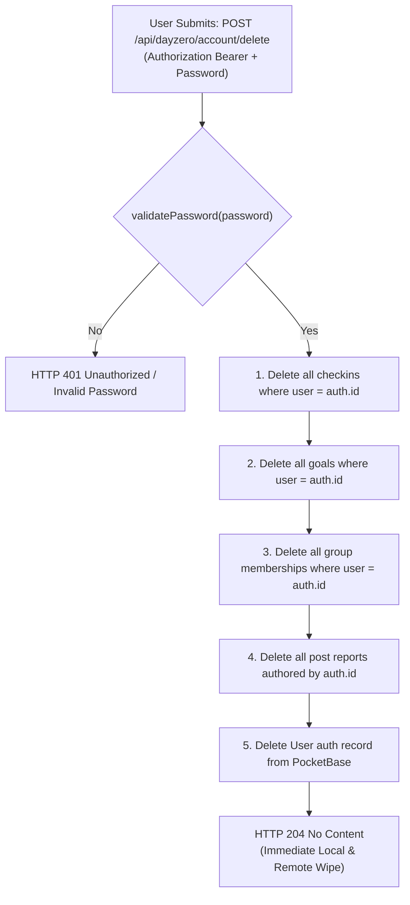

# DayZero — Security Architecture & Threat Modeling Report

## 1. Security Philosophy: Never Trust the Client

DayZero follows a strict zero-trust client model. Every access boundary, role transition, check-in privacy rule, invitation validation, and account deletion is enforced **server-side** inside PocketBase Goja hooks (`pb_hooks/`) and declarative collection API rules (`pb_migrations/`).

Direct REST API calls made with curl or custom scripts cannot bypass these protections.

---

## 2. Threat Modeling & Mitigation Matrix

| Threat / Attack Vector | Severity | Vulnerability Description | DayZero Mitigation & Verification |
| :--- | :--- | :--- | :--- |
| **Privilege Escalation** | CRITICAL | Malicious user attempts to set `role: "moderator"` during membership creation or update. | **Mitigated.** Collection rule requires `@request.body.role:isset = false \|\| @request.body.role = "member"`. Server hook (`001_authorization.pb.js`) actively validates role and aborts with HTTP 403 if an unprivileged user targets moderator status. *(Verified in automated test `ST-SEC-01`)* |
| **Check-in Data Leakage** | CRITICAL | Unauthorized user or attacker attempts to read another member's daily mood or recovery notes. | **Mitigated.** `checkins` collection rule enforces `@request.auth.id != "" && @request.auth.id = user`. Cross-user GET requests return HTTP 404 or an empty set. *(Verified in automated test `ST-SEC-02`)* |
| **Forged Check-in Injection** | HIGH | User attempts to record check-ins under another account's ID or spoof calendar dates. | **Mitigated.** `user` field in `checkins` is forcibly bound to `@request.auth.id`. `localDate` is calculated deterministically on the server using the user's registered timezone offset (UTC+5:30 for Kerala). *(Verified in test `ST-SEC-03`)* |
| **Group Eavesdropping** | HIGH | Non-member queries private group discussion feed or member roster. | **Mitigated.** `posts` collection rule verifies active membership via existential quantification: `@collection.memberships:auth.group ?= group && @collection.memberships:auth.user ?= @request.auth.id && @collection.memberships:auth.status ?= "active"`. *(Verified in test `ST-SEC-04`)* |
| **Invitation Code Replay** | MEDIUM | Attacker attempts to reuse an expired or single-use invitation code. | **Mitigated.** Invitation redemption occurs exclusively through the custom atomic endpoint `/api/dayzero/community/join`. Checks `status === "active"`, verifies `expiresAt > NOW()`, verifies `usedCount < maxUses`, and atomically increments count or marks `exhausted`. *(Verified in test `ST-SEC-05`)* |
| **Unauthorized Moderation** | HIGH | Non-moderator attempts to view reports or resolve complaints against posts. | **Mitigated.** `reports` view rule requires `@collection.memberships:auth.group ?= post.group && @collection.memberships:auth.user ?= @request.auth.id && @collection.memberships:auth.role ?= "moderator"`. Regular members receive HTTP 404. *(Verified in test `ST-SEC-06`)* |
| **Unauthenticated Deletion** | CRITICAL | Stolen session token used to wipe user account without re-authentication. | **Mitigated.** `/api/dayzero/account/delete` mandates the account password in the POST body. Re-verifies credentials with `authRecord.validatePassword(password)`. Unauthenticated or incorrect password attempts return HTTP 401. *(Verified in test `ST-SEC-07`)* |
| **Admin Credential Exposure**| CRITICAL | Admin credentials bundled into client web/mobile bundles. | **Mitigated.** Zero admin accounts are created by default in seed scripts or client bundles. Client apps operate exclusively through standard user auth endpoints. PocketBase admin UI (`/_/`) is restricted by Caddy. |

---

## 3. Server-Side Cascading Erasure Architecture

When a user exercises their Right to Erasure, DayZero does not simply mark the record as soft-deleted. The server hook `/api/dayzero/account/delete` executes a comprehensive multi-table purge:

---

## 4. Operational Risk & Single-Server Hardening

### Limitations of Single-Server PocketBase:
- **No Horizontal Multi-Master Scaling:** PocketBase embeds SQLite. It cannot run across multiple active-active nodes with synchronous multi-region writes.
- **Failover:** In case of hardware outage, service recovery relies on cold failover using automated daily backups.
- **Acceptable SLA:** For a community recovery platform of up to 50,000 users, single-server PocketBase comfortably handles 500+ requests/second on a $5/mo VPS, offering 99.9% uptime when paired with Caddy.

### Host Hardening Guidelines:
1. **File Permissions:** `chmod 700 pb_data`, `chmod 600 pb_data/data.db`.
2. **Reverse Proxy:** Run PocketBase strictly bound to `127.0.0.1:8090`. Never expose port 8090 directly to the public Internet.
3. **Caddy Security Headers:** Enforce `Strict-Transport-Security`, `X-Frame-Options DENY`, and strict `Content-Security-Policy`.
4. **Admin Protection:** Configure Caddy to reject public access to `/_/*` or restrict access to internal VPN IP ranges (e.g., Tailscale / WireGuard).
